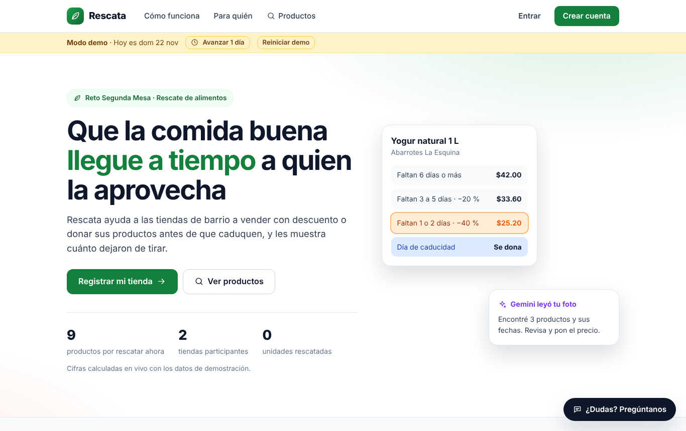

# Rescata

**Que la comida buena llegue a tiempo a quien la aprovecha.**

Rescata es una página web para tiendas de barrio, compradores y organizaciones. La tienda registra sus productos por caducar (con una foto, por voz o a mano), el precio baja por etapas conforme se acerca la fecha y, si nadie los compra, el día que caducan se ofrecen a comedores y albergues. Cada unidad termina con un resultado medido: vendida, donada o desechada. Un asistente con Gemini resuelve las dudas de cualquier usuario.

Proyecto del **Reto Segunda Mesa** (Taller de Hackathon Hackateate).



---

## 1. Reto y problema

**Pregunta del reto:** ¿cómo lograr que el alimento que hoy se tira llegue, a tiempo y sin fricción, a quien sí puede aprovecharlo?

**Contexto nacional (dato secundario):** se estima que en México se desperdician 20.4 millones de toneladas de alimentos al año, cifra que Expansión (30/09/2025) atribuye a la FAO, según la guía del reto. Es contexto nacional, no una medición de nuestra comunidad.

**Problema que investigamos:** en tiendas de abarrotes cerca de [COMPLETAR: campus o colonia], la persona encargada pierde productos perecederos (lácteos, pan, embutidos, fruta) porque [COMPLETAR con lo que encontraron en las entrevistas].

**Evidencia propia:** [COMPLETAR: número de entrevistas, tiendas observadas y hallazgos principales]. Notas completas en [`docs/investigacion/`](docs/investigacion/).

## 2. Usuarios

| Usuario | Quién es | Qué necesita |
| --- | --- | --- |
| Tienda (usuario principal y quien paga) | Encargado o dueño de una tienda de barrio | Saber qué caduca pronto y moverlo sin perder tiempo |
| Comprador | Estudiantes y vecinos | Productos en buen estado a menor precio, cerca |
| Organización receptora | Comedor comunitario, albergue o banco de alimentos | Avisos con cantidad y horario de recogida claros |

## 3. Solución: la escalera de rescate

1. **Registro:** la tienda toma una foto (de una etiqueta o del refrigerador completo) o dicta lo que le sobró. Gemini llena los datos y la tienda los revisa, pone el precio y confirma.
2. **Precio normal** cuando faltan más de 5 días.
3. **Descuento automático por etapas:** 20 % de 3 a 5 días y 40 % con 1 o 2 días (cada tienda ajusta sus porcentajes). Cualquiera ve los productos; con cuenta de comprador se apartan y se recogen en la tienda. La tienda comparte sus ofertas por WhatsApp.
4. **Donación:** el día que caduca, el producto deja de venderse y las organizaciones lo apartan con hora de recogida.
5. **Resultado medido:** al caducar, lo que nadie recogió se registra como desechado. El tablero de impacto muestra el % rescatado, las unidades vendidas, donadas y desechadas, y el dinero recuperado.

**Asistente de dudas:** un chat con Gemini en todas las páginas. Conoce cómo funciona Rescata, el rol de quien pregunta y los productos disponibles hoy.

**Propuesta de valor:** la tienda toma una foto y la app se encarga de rescatar el producto (primero vendiéndolo con descuento, luego donándolo) y le muestra cuánto dejó de tirar.

### Decisiones clave

| Decisión | Por qué |
| --- | --- |
| Gemini **sugiere**, la tienda **confirma** | Una fecha o una foto en la app no certifica que un alimento sea apto; la responsabilidad es de la tienda. |
| El precio lo calcula una **regla fija en código**, no la IA | Se puede explicar, probar y ajustar. |
| Donación como último escalón | Es lo que nos distingue de las apps que solo venden con descuento. |
| Cuentas por rol | Cada quien ve y modifica solo lo suyo. |
| Catálogo visible sin cuenta | Menos fricción: la cuenta se pide solo al apartar. |

Todas las alternativas comparadas: [`docs/decisiones.md`](docs/decisiones.md).

## 4. Tecnologías

| Tecnología | Para qué | Por qué la elegimos |
| --- | --- | --- |
| Python 3 + Flask | Servidor web, páginas y cuentas | Un solo lenguaje, fácil de aprender y de explicar |
| SQLite | Base de datos | No requiere instalar nada; SQL sencillo para las métricas |
| HTML + CSS + JavaScript | Pantallas, dictado por voz y chat | Funciona en cualquier navegador y celular |
| Gemini API (`google-genai`) | Leer fotos y dictados, alertas, mensajes, recomendaciones y asistente | Entiende imágenes y texto, y devuelve JSON con un esquema fijo (salida estructurada) |
| Werkzeug (incluido en Flask) | Cifrar contraseñas | Las contraseñas nunca se guardan tal cual |
| pytest | Pruebas automáticas | Comprueba las reglas que pueden fallar |

## 5. Cómo ejecutarlo

### Requisitos

- [Python 3.10 o más nuevo](https://www.python.org/downloads/) (en Windows marca "Add Python to PATH").
- Opcional: una clave gratuita de Gemini de [Google AI Studio](https://aistudio.google.com/apikey).

### Instalación y configuración

```
pip install -r requirements.txt
```

1. Copia `.env.example` y renómbralo como `.env`.
2. En `.env`, escribe un texto largo en `SECRET_KEY=` y pega tu clave en `GEMINI_API_KEY=`.
3. **Nunca subas el archivo `.env` a GitHub** (ya está en `.gitignore`). Sin clave, la app funciona en **modo simulado** con respuestas de ejemplo marcadas en pantalla.
4. Para revisar que la clave funciona: `python probar_gemini.py`. Prueba el modelo principal y el de respaldo y explica cualquier error.

### Ejecutar

```
python app.py
```

Abre http://127.0.0.1:5000. La primera vez se crea `rescata.db` con datos de demostración.

### Cuentas de demostración

Todas con la contraseña `rescata123` (también aparecen en la pantalla "Entrar"):

| Cuenta | Rol |
| --- | --- |
| `tienda@demo.mx` | Tienda: Abarrotes La Esquina |
| `panaderia@demo.mx` | Tienda: Panadería San José |
| `comprador@demo.mx` | Comprador |
| `comedor@demo.mx` | Organización: Comedor comunitario |

### Pruebas automáticas

```
python -m pytest
```

83 pruebas: cuentas y permisos por rol, contraseñas cifradas, apartados simultáneos sin pasarse de lo disponible, cancelaciones, cantidades inválidas, descuentos, paso a donación, cierre con desechos, tablero, protección CSRF, integración con Gemini (reintentos y modelo de respaldo) y asistente en modo simulado.

## 6. Qué es real y qué es simulado

| Parte | Estado |
| --- | --- |
| Cuentas, registro de productos, apartados, descuentos, donación, cierre y tablero | Funcionan de verdad con la base de datos |
| Gemini (captura, textos y asistente) | Real si hay `GEMINI_API_KEY`. Si Google está saturado, reintenta y usa un modelo de respaldo; si aun así falla, o si no hay clave o `GEMINI_MOCK=true`, usa respuestas de ejemplo y la pantalla indica el motivo |
| Reloj | En la demo, "Avanzar 1 día" adelanta la fecha para recorrer la escalera en segundos |
| Tiendas, organizaciones y cuentas | Datos de demostración ficticios |
| Dictado por voz | Reconocimiento de voz del navegador (Chrome o Edge); Gemini interpreta el texto |

## 7. Evidencia y capturas

Capturas en [`docs/capturas/`](docs/capturas/). Resultados de las pruebas con usuarios en [`docs/pruebas/`](docs/pruebas/).

[COMPLETAR: resultados de la prueba con usuarios: tiempo para registrar con foto contra a mano, tareas completadas, qué cambiaron después.]

## 8. Estructura del proyecto

```
app.py                  arranca la app y une todas las partes
db.py · schema.sql      base de datos
datos_demo.py           tiendas, cuentas y productos ficticios para la demo
reglas.py               reglas del negocio (descuentos, escalera, validaciones)
servicio.py             operaciones que guardan o cambian datos
auth.py                 crear cuenta, entrar, salir y permisos por rol
gemini.py               todo lo que hace Gemini, con modo simulado
rutas_tienda.py         páginas de la tienda
rutas_comprador.py      páginas del comprador
rutas_organizacion.py   páginas de la organización
rutas_ia.py             páginas de la tienda que usan Gemini
rutas_chat.py           asistente de dudas
rutas_demo.py           botones de la demo (avanzar día, reiniciar)
probar_gemini.py        diagnóstico de la conexión con Gemini
templates/              pantallas (HTML)
static/                 estilos, dictado por voz y chat
tests/                  pruebas automáticas
docs/                   investigación, decisiones, plan de negocio y guías del equipo
```

Explicación archivo por archivo, para defender el proyecto: [`docs/como-funciona.md`](docs/como-funciona.md). Una guía por versión, con lo que agrega cada una: [`docs/guias/`](docs/guias/). Guion de la demo: [`docs/guion-demo.md`](docs/guion-demo.md).

## 9. Equipo

| Integrante | Rol | Perfil de GitHub |
| --- | --- | --- |
| [COMPLETAR] | Producto e investigación | |
| [COMPLETAR] | Frontend (pantallas) | |
| [COMPLETAR] | Backend y base de datos | |
| [COMPLETAR] | Gemini e integración | |
| [COMPLETAR] | Negocio y presentación | |

**Uso de IA en el desarrollo:** [COMPLETAR: declaren con honestidad qué herramientas de IA usaron para programar y documentar, y qué hizo el equipo.]

## 10. Plan de negocio

[`docs/plan-negocio.md`](docs/plan-negocio.md)

## 11. Limitaciones y próximos pasos

- Prototipo local: falta publicarlo en internet con una base de datos de producción.
- No hay recuperación de contraseña ni verificación de correo.
- La lectura de fechas con Gemini puede equivocarse; por eso siempre la confirma una persona. [COMPLETAR: cuántas etiquetas leyó bien en sus pruebas.]
- El asistente puede equivocarse; sus instrucciones le prohíben inventar productos o certificar alimentos.
- El impacto de la demo usa datos ficticios; falta un piloto de varias semanas con tiendas reales.

## Fuentes

- Guía del Reto Segunda Mesa, Taller de Hackathon (2026).
- Expansión, "FAO: México desperdicia cada año 20.4 millones de toneladas de alimentos", 30/09/2025 (citada por la guía del reto).
- [Ley General de la Alimentación Adecuada y Sostenible](https://www.diputados.gob.mx/LeyesBiblio/pdf/LGAAS.pdf), DOF 17/04/2024.
- [Documentación de la Gemini API: salida estructurada](https://ai.google.dev/gemini-api/docs/structured-output).
